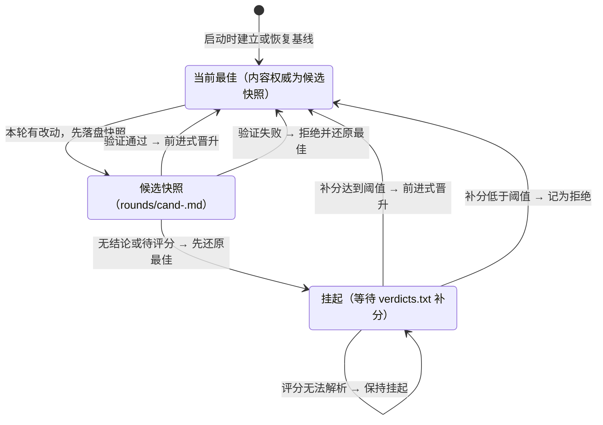

# xuen

用「随机灵感词 × 外部 agent」模拟人类研究者持续演进想法的 **TUI** 循环。

xuen 自身不调用模型，也不内置研究工具。它负责组织循环、维护状态、展示变化并保存进度；
真正的思考与写作交给外部 agent（如 opencode、claude、aider）。每一轮，xuen 把任务、
随机灵感词、当前想法区/产物区和写入说明拼成提示词，外部 agent 完成后覆盖对应区块。

## 目录

- [核心概念](#核心概念)
- [快速开始](#快速开始)
- [工作流程](#工作流程)
- [TUI](#tui)
- [轮次守卫](#轮次守卫)
- [配置参考](#配置参考)
- [退出码](#退出码)
- [目录结构](#目录结构)
- [在 CI 中无人值守长跑](#在-ci-中无人值守长跑)
- [开发与测试](#开发与测试)
- [代码体量纪律](#代码体量纪律)
- [功能对照](#功能对照)

## 核心概念

| 概念 | 说明 |
|---|---|
| 任务 | 本轮研究的总目标，可来自命令行参数、`--task-file` 或交互输入 |
| 灵感词 | 每轮从领域词库中**纯随机**抽取的术语，抽样不调用任何模型 |
| 想法区 | `research.md` 中跨轮保留的 `IDEA` 区块，记录研究思路 |
| 产物区 | `research.md` 中跨轮保留的 `ARTIFACT` 区块，记录方案、伪代码、推导或实验设计 |
| 外部 agent | 由 `agent.command` 指定的 shell 命令，负责每轮的实际思考与区块写入 |
| 轮次守卫 | 可选的进度保护层：快照每轮产物，验证通过后才晋升为「当前最佳」 |

## 快速开始

需要 Python 3.9 或更高版本。

```bash
# 1. 安装运行时依赖
python -m pip install -r requirements.txt

# 2. 复制示例配置，并按需修改 agent.command
cp config.example.yaml config.yaml

# 3. 启动 TUI（默认）
python main.py "设计一个新的优化器"
```

也可以安装为命令；安装后可用 `xuen --help` 查看全部参数：

```bash
python -m pip install -e .
xuen "设计一个新的优化器"
```

未用 `-c/--config` 指定时，程序依次查找当前目录的 `config.yaml`、`config.yml`、
`xuen.yaml`。除 `agent.command` 外，其余配置均可省略并使用默认值。

`agent.command` 必须包含一个会被实际替换的提示词占位符。跨平台场景推荐
`$prompt_file`，它只向命令传递文件路径，不受命令行长度限制：

```yaml
agent:
  # 推荐：提示词写入工作区内的临时文件，命令只接收路径
  command: 'opencode run "$prompt_file"'
  # 也可以直接传入整段提示词（受系统单参数长度限制）
  # command: 'opencode run "$prompt"'
```

常用命令：

```bash
python main.py "设计一个新的优化器" --no-tui          # 纯终端输出
python main.py "设计一个新的优化器" --iterations inf --pick 3
python main.py "设计一个新的优化器" --regen-words     # 忽略旧词库并重建
python main.py --task-file task.md --no-tui
python main.py "设计一个新的优化器" --rounds-verify ai --rounds-score 8
python main.py "设计一个新的优化器" --no-rounds       # 关闭轮次守卫
python main.py "设计一个新的优化器" -c my-config.yaml
python main.py --help                                 # 查看所有参数
```

任务可以是位置参数，也可以用 `--task-file` 从 UTF-8 文件读取（兼容 BOM）；两者
不能同时使用。未提供任务且 stdin 可用时，程序会交互询问。

想先不配置外部 agent，可以直接运行最小示例：

```bash
python examples/minimal_demo.py
```

示例用 `examples/mock_agent.py` 扮演外部 agent，在临时目录中演示「随机抽词 →
提示词渲染 → 候选快照 → 验证 → 晋升最佳」的完整流程。默认结束后清理临时工作区，
`--keep` 可保留 `research.md`、`rounds/cand-*.md`、`rounds/best.md` 等文件。
详见 `examples/README.md`。

## 工作流程

```text
python main.py "任务"
   │
   ├─ ① 解析命令行 → 读取配置文件 → 应用 CLI 覆盖 → 校验
   ├─ ② 准备工作区：research.md（想法区/产物区）+ write_section.py 写入助手
   ├─ ③ 构建外部 agent：ShellAgent（按 agent.command 模板调用）
   ├─ ④ 启动轮次守卫（可选）：建立/恢复最佳基线，兑现待决用户评分
   │
   ├─ ⑤ 领域词库（仅 words.pick > 0 时）
   │      words.txt 已存在且 reuse=true ──► 直接复用（--regen-words 强制重建）
   │      否则 ──► 外部 agent 分批生成 ──► 解析/清洗/去重 ──► 原子保存
   │
   └─ ⑥ 研究循环 × N 轮（loop.iterations，支持 inf）
          1. 纯随机抽词：从词库抽取 n 个灵感词（不调用任何模型）
          2. 收集底部输入框中积累的用户输入
          3. 拼提示词：extra_notes + 任务 + 轮次 + 灵感词 + 用户输入
             + 当前想法区/产物区 + 覆盖区块的写入指令
          4. 调用外部 agent：输出实时显示；agent 覆盖想法区/产物区
          5. 重读 research.md 并比较：哪个区块变化就显示对应内容
          6. 轮次守卫（默认启用）：快照 → 验证 → 晋升或还原
             （守卫异常一律降级，不阻断研究循环）
```

### 启动与配置

入口是 `main.py`，命令行解析与配置覆盖在 `xuen/cli.py`：

- 任务可来自位置参数、`--task-file`，或未提供时的交互输入；
- 配置文件默认依次查找当前目录的 `config.yaml`、`config.yml`、`xuen.yaml`，
  也可用 `-c/--config` 指定；
- 命令行参数覆盖同名配置后会重新校验，避免绕过路径、轮数等约束；
- 完整字段与默认值见下文「配置参考」，可复制 `config.example.yaml` 作为起点。

### 状态文件与写入助手

`xuen/state.py` 负责 `research.md`：

- 标题为任务，正文包含 `IDEA` 与 `ARTIFACT` 两个标记区块；文件已存在时续用；
- 区块以 `<!-- IDEA:START -->` / `<!-- IDEA:END -->` 这类独占行标记定位；
- 更新时整体覆盖指定区块，并校验另一区块读出的内容不受影响；
- 写入使用临时文件 + 原子替换，并通过 sidecar 锁串行化跨进程读-改-写。

工作区中还会生成独立的 `write_section.py`，供外部 agent 从 shell 调用：

```bash
cat new_idea.md | python write_section.py idea
cat new_artifact.md | python write_section.py artifact
python write_section.py show
```

### 外部 agent 调用

`xuen/agents.py` 中的 `ShellAgent` 负责渲染命令模板并管理进程：

- `$prompt`：把整段提示词按所在 shell 语境转义后替换；
- `$prompt_file`：把提示词写入工作区内本次运行唯一的 `.prompt.XXXXXX.md`，
  再把占位符替换为文件路径，运行结束后自动清理（跨平台推荐）；
- 模板中的命令替换、heredoc、注释、算术展开等区域不会被误替换；无法安全处理的
  写法会在配置校验阶段直接报错；
- `agent.timeout` 超时后终止整个进程树；TUI 中按 `q` / `Ctrl+C` 也会先终止
  正在运行的 agent；
- `$prompt` 模式遇到系统单参数长度上限时，会提示改用 `$prompt_file` 并中止循环。

### 词库生成

`xuen/words.py` 负责词库的生成、解析、持久化与抽样：

- 按 `words.batch` 分批请求外部 agent 列出术语/关键词；
- 程序只做解析、清洗、去重（去除序号、引号、冒号解释等）并原子写入 `words.txt`；
- 词表不再增长时提前结束；生成结果为空且允许复用时回退到磁盘上的旧词库；
- `words.pick=0` 时跳过词库，循环中不提供灵感词；
- 每轮抽样使用 `random.sample`，不调用任何模型。

### 提示词预算

每轮提示词都会附带完整的想法区/产物区，轮次增加后会单调增长。`prompt.max_state_chars`
为两区总字符数设置上限：

```yaml
prompt:
  max_state_chars: 60000   # 0 = 不限制
```

超出时只截断**提示词副本**：保留首尾，中间标注省略字符数，并提示完整内容仍在
`research.md`；工作区文件本身不会被裁剪。

## TUI

默认界面从上到下分为：

```text
┌ 修改想法区 ────────────────┐
│ [修改想法区]               │  ← 想法区被覆盖后显示
│ <写入想法区的内容>          │     [修改想法区]<写入想法区的内容>
├ 修改产物区 ────────────────┤
│ [修改产物区]               │  ← 产物区被覆盖后显示
│ <写入产物区的内容>          │     [修改产物区]<写入产物区的内容>
├ 输出日志 ──────────────────┤
│ 外部 agent 的 stdout/stderr │
│ 与循环消息（滚动）           │
├────────────────────────────┤
│ 状态栏                     │
└ 输入框                     ┘
  输入内容会在下次调用 agent 时带给 agent
```

- 底部输入框回车提交后进入队列，下一轮调用 agent 时以「【用户输入】」段落拼进提示词；
- 输入框为空时按 `q` 退出，`Ctrl+C` 中断退出（两者都会先终止正在运行的外部 agent）；
- 未安装 `textual`、stdin/stdout 不是终端，或指定 `--no-tui` 时，自动降级为纯终端输出。

## 轮次守卫

外部 agent 每轮会**整体覆盖**想法区/产物区。若某轮产出更差的内容，直接继承最新
状态会让更好的前一轮结果被覆盖。轮次守卫（`xuen/rounds.py`，配置段 `rounds:`）
把「每轮快照、候选/最佳分离、自动验证、渐进翻案」组合起来，保证进度可回退到最近
的已验证内容。

### 候选生命周期



终端中的实际过程：

```text
每轮结束
  │
  ├─ 无改动 → 记「心跳」，不产生候选
  ├─ 区块标记损坏 → 守卫直接拒绝，还原最佳
  ├─ 有改动 → ① 快照为 rounds/cand-<id>.md（候选 ≠ 最佳）
  │        │
  │        ├─ ② 按 rounds.verify 验证
  │        │    auto  有可运行测试就跑测试；没有则用 fallback 评分者
  │        │    tests 只跑测试（pytest → make → npm → go 级联）
  │        │    user  只认 verdicts.txt 用户评分
  │        │    ai    复用外部 agent 当评审员（judge_command 可配便宜模型）
  │        │    off   不验证，最新即最佳（仅「防丢失」模式）
  │        │
  │        ├─ ③ 通过 → 前进式晋升为最佳
  │        │    rounds/best.md + best.json 更新（不改写历史）
  │        └─ ③ 失败 / 无结论 → research.md 还原为当前最佳
  │             —— 下一轮永远从最佳出发
  │
  ├─ 挂起候选可在 rounds/verdicts.txt 追加评分
  │        └─ 补分 ≥ 阈值 → 旧快照晋升为最佳并写回 research.md
  └─ 全部事件追加进 rounds/history.jsonl（审计用，只增不改）
```

### 验证方式

| `rounds.verify` | 行为 |
|---|---|
| `auto` | 有可运行测试套件就跑测试（pytest → make → npm → go 级联）；没有则使用 `rounds.fallback` 指定的评分者 |
| `tests` | 只跑测试；没有套件或套件无法运行时，候选挂起等待用户评分 |
| `user` | 只认用户评分（`verdicts.txt` 异步补分，可跨会话翻案） |
| `ai` | 只用 AI 评分（`judge_command` 可单独配置评审模型） |
| `off` | 不验证：快照照存，最新即最佳 |

Makefile 只做文件存在性探测；是否定义了 `test` 目标由 GNU make 在运行时回答。
`No rule to make target 'test'`、`Nothing to be done for 'test'`、pytest 退出码 5、
go 的 `matched no packages` / 全部 `[no test files]` 都按「套件不可用」处理，
而不是测试失败。

### 用户评分与渐进翻案

每行一个评分，格式为 `<候选id> <0-10分> [评语]`，追加到
`<workspace>/rounds/verdicts.txt`：

```text
20261017-031037-r5 8 想法区更有深度，产物区伪代码可落地
20261018-014512-r12 6
```

守卫会在启动时、每轮结束和收尾时兑现待决评分。达到 `adopt_score` 的旧候选会被
「前进式晋升」为最佳并写回 `research.md`；低于阈值则记为拒绝。未知候选 id、
无法解析的分数、缺失的快照都不会锁死循环：能忽略的忽略，无法判断的保持挂起。

### AI 评审

研究与评审对模型的要求不同，可以用 `rounds.judge_command` 给评审员单独配置
更快、更便宜的模型（占位符与 `agent.command` 相同）：

```yaml
rounds:
  verify: ai
  judge_command: 'opencode run -m opencode/deepseek-v4.1-flash-free "$prompt"'
  judge_timeout: 600
```

评审员看到的是候选快照与当前最佳，而不是可能被外部改写的实时状态；评分达到
`adopt_score` 才采纳。评审员超时、非零退出或输出无法解析时，候选按挂起处理，
不会因为评审基础设施故障而被误判为差候选。

### 持久化与恢复

所有持久状态都在工作区文件中：

- `research.md`：当前想法区/产物区；
- `words.txt`：领域词库；
- `rounds/cand-*.md`：每轮候选快照（`O_EXCL` 原子创建）；
- `rounds/best.md` / `rounds/best.json`：当前最佳的镜像与元数据；
- `rounds/history.jsonl`：追加式审计日志；
- `rounds/verdicts.txt`：用户评分。

候选快照是最佳内容的权威来源，`best.md` 只是便于查看和 diff 的镜像。启动时先读取
`best.json` 元数据，缺失或损坏时从 `history.jsonl` 的基线/采纳事件恢复；内容优先
取对应候选快照，快照不可用才回退到 `best.md`，两者都没有时以当前状态建立基线。
随后守卫会把 `research.md` 拨回最近的最佳状态。进程被中断或中途退出后，重跑会从
已验证的进展继续。

### 快捷参数

`--no-rounds` 关闭守卫；`--rounds-verify auto|tests|user|ai|off` 指定验证方式；
`--rounds-fallback user|ai` 指定兜底评分者；`--rounds-score N` 设置采纳阈值。

## 配置参考

完整示例见 `config.example.yaml`。主要字段：

| 字段 | 默认值 | 说明 |
|---|---|---|
| `agent.command` | 空 | 外部 agent 命令模板，必须包含 `$prompt` 或 `$prompt_file` |
| `agent.timeout` | `1800` | 单次外部调用超时（秒） |
| `extra_notes` | 空 | 拼进每轮提示词开头的额外说明 |
| `prompt.max_state_chars` | `60000` | 想法区/产物区拼进提示词的字符预算；`0` 表示不限制 |
| `words.count` | `1000` | 目标词数 |
| `words.batch` | `100` | 每批请求的词数 |
| `words.pick` | `2` | 每轮随机抽取的灵感词数量；`0` 表示不抽词 |
| `words.reuse` | `true` | `words.txt` 已存在时是否直接复用 |
| `loop.iterations` | `5` | 循环轮数；`inf` 表示无限循环 |
| `rounds.enabled` | `true` | 是否启用轮次守卫 |
| `rounds.dir` | `rounds` | 守卫目录（相对工作区） |
| `rounds.verify` | `auto` | 候选验证方式 |
| `rounds.fallback` | `ai` | `auto` 模式无测试可用时的兜底评分者 |
| `rounds.adopt_score` | `7` | 采纳候选的最低评分（0-10） |
| `rounds.verify_timeout` | `600` | 单次测试套件运行超时（秒） |
| `rounds.repo` | 空 | 测试验证的目标目录；留空时自动探测 |
| `rounds.judge_command` | 空 | AI 评审命令模板；留空复用 `agent.command` |
| `rounds.judge_timeout` | `600` | AI 评审超时（秒） |
| `tui` | `true` | 是否启用 TUI |
| `color` | `true` | 纯终端输出是否使用颜色 |
| `workspace` | `./workspace` | `research.md`、`words.txt`、`rounds/` 等所在目录 |

`workspace` 等路径按启动时的当前目录解析；`rounds.dir` 则相对 `workspace`。
当 `rounds.repo` 留空时，守卫会从工作区向上查找 git 仓库根；非 git 环境使用
工作区本身。要打磨某个代码仓库时，把 `rounds.repo` 指向它，候选改动会被该仓库
的测试套件自动验证。

## 退出码

| 退出码 | 含义 |
|---|---|
| `0` | 正常结束 |
| `1` | 循环中止（所有轮次失败、提示词过长、TUI 启动失败等） |
| `2` | 配置或参数错误 |
| `130` | 被 `Ctrl+C` 中断 |

## 目录结构

```text
xuen/
├── main.py                    # 入口
├── requirements.txt           # 运行时依赖（PyYAML / textual / rich）
├── requirements-ci.txt        # CI 固定版本依赖
├── requirements-dev.txt       # 开发依赖
├── pyproject.toml             # 包元数据与 pytest 配置
├── config.example.yaml        # 复制为 config.yaml 使用
├── examples/                  # 最小可运行示例（mock agent，无需外部可执行文件）
├── scripts/check_file_size.py # 3,000 行体量门禁
├── .github/workflows/         # CI / 自动研究循环 / issue 处理 / Gitee 同步
├── tests/                     # pytest：守卫、shell 渲染、词库、TUI、配置、仓库卫生等
└── xuen/
    ├── cli.py                 # 命令行（TUI 导入失败时降级到纯终端）
    ├── config.py              # 配置加载与校验
    ├── tui.py                 # TUI（textual）：区块面板 + 日志 + 底部输入框
    ├── sink.py                # 输出通道抽象（控制台 / TUI 共用）
    ├── ui.py                  # 纯终端输出（--no-tui）
    ├── state.py               # research.md（想法区/产物区）+ 写入助手脚本
    ├── words.py               # 词库：外部 agent 生成 / 解析 / 抽样
    ├── procs.py               # 跨平台进程工具
    ├── agents.py              # ShellAgent + 命令模板转义/安全检查
    ├── rounds.py              # 轮次守卫：快照/验证/晋升/还原 + 渐进翻案
    └── runner.py              # 主循环编排
```

工作区的运行期状态（`research.md`、`words.txt`、`write_section.py`、`rounds/`
等）与源码目录分离；本地运行默认写入被 `.gitignore` 忽略的 `workspace/`，
CI 长跑则通过专用 checkpoint 分支保存进度。

## 在 CI 中无人值守长跑

`.github/workflows/continuous-loop.yml` 把研究循环搬进 GitHub Actions，并行运行
「设计一个新的算法」和「寻找参加 UniBot 的创新点」两个任务。两个 job 各有约
3 小时工作窗口，窗口结束前发送 SIGINT 优雅收尾；均使用 `rounds.verify: ai` 与
独立的 `rounds.judge_command` 评审配置。

两个任务的工作区分别通过专用的 `xuen-loop` / `xuen-loop-unibot` 分支跨 run
保存：每次运行开头恢复、结尾 checkpoint，不改动 `master`。配合每轮落盘的候选
快照，即使某次运行中途失败，下一次也能从最近的已验证进展继续。

## 开发与测试

```bash
# 运行时依赖
python -m pip install -r requirements.txt

# 开发安装（含 pytest / pytest-cov）
python -m pip install -e ".[dev]"

# 或不安装包，只安装开发依赖
python -m pip install -r requirements-dev.txt

python -m pytest -q
python -m pytest --cov=xuen --cov-report=term-missing
```

测试覆盖轮次守卫、shell 提示词渲染与注入防护、词库、配置、TUI 输入/降级/退出、
仓库卫生、日志清洗、体量门禁、CLI 与冒烟流程。CI 使用 `requirements-ci.txt`
中的固定版本依赖。

默认分支是 `master`。

## 代码体量纪律

**3,000 行是单文件红线。** `scripts/check_file_size.py` 扫描仓库内所有手写
`.py` 文件（排除 `pkg.generated*`、缓存目录与虚拟环境），任何文件超过 3,000 行
都会打印路径并以非零码退出。生成物不计入，人工维护的源码没有例外。

修改代码时遵循：

- **优先删减，而非追加。** 能删除的旧路径、重复状态和无效兼容层优先删除；
  新增逻辑前先确认现有实现不能收拢复用。
- **按职责拆分，而不是按行数切块。** 单文件接近红线时，先识别可独立的渲染、
  解析、提示词组装等职责，再迁到同包模块；测试按被测功能拆分。
- **拆分只做物理重组。** 移动代码不改变逻辑、不削弱断言，现有测试必须保持全绿。

## 功能对照

| 需求 | 实现 |
|---|---|
| 只调用外部 agent | 外部调用集中在 `ShellAgent`；词库也由外部 agent 生成；无直连 LLM |
| 配置 shell 命令调用外部 agent | `agent.command` + `$prompt` / `$prompt_file` |
| TUI | `textual` 实现，默认启用；不可用时自动降级 |
| 想法区/产物区变化展示 | TUI 面板显示 `[修改想法区]<内容>` / `[修改产物区]<内容>` |
| 底部输入框 | 输入入队，下一轮提示词中以「【用户输入】」段落带给 agent |
| 状态持久化 | `research.md` 标记区块；重跑自动续用 |
| 候选与最佳分离 | `rounds/cand-*.md` + `best.md` / `best.json` + `history.jsonl` |
| 自动验证 | `rounds.repo` 目标目录的 pytest → make → npm → go 级联 |
| 用户评分 / AI 评分 | `verdicts.txt` 异步补分 / 外部 agent 评审员 |
| 避免覆盖更好方案 | 失败或挂起即还原最佳；下一轮从最佳出发 |
| 提示词不无限增长 | `prompt.max_state_chars` 首尾截断 + 截断提示 |
| CI 自动循环且进度可续 | `continuous-loop.yml` + 专用 checkpoint 分支 |

## 友链
[LINUX DO](https://linux.do/)
