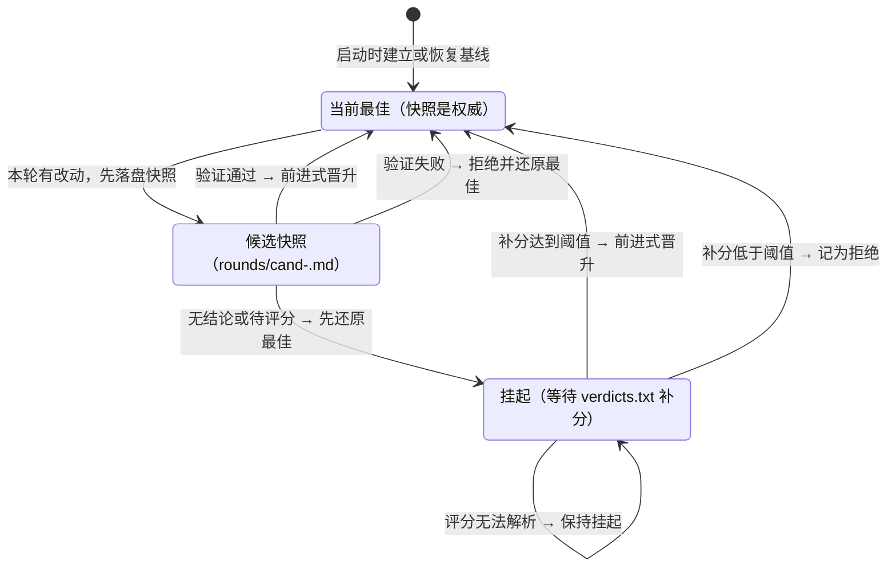

# xuen

**随机灵感词 × 外部 agent 研究循环**（TUI 模式）

xuen 通过「随机抽取灵感词」+「外部 agent 思考」模拟人类研究者的迭代研究流程：

1.  从领域词库中**纯随机**抽取灵感词（不调用模型）
2.  将任务、灵感词、当前想法区/产物区拼成提示词
3.  外部 agent（如 opencode）完成思考并覆盖对应区块
4.  xuen 显示区块变化，选用「轮次守卫」机制保存快照并验证

> **注意**：xuen 本身不调用任何 LLM。所有思考由外部 agent 完成，xuen 只负责循环组织、状态持久化、TUI 展示与轮次守卫。

## 核心概念

| 概念 | 说明 |
|---|---|
| **任务** | 整轮研究的总目标，可来自位置参数、`--task-file` 或交互输入 |
| **灵感词** | 每轮从领域词库中纯随机抽取的术语；抽样过程不调用模型 |
| **想法区** | `research.md` 中跨轮保留的 `IDEA` 区块，记录研究思路 |
| **产物区** | `research.md` 中跨轮保留的 `ARTIFACT` 区块，记录方案、伪代码、推导、实验设计等 |
| **外部 agent** | 由 `agent.command` 指定的 shell 命令，负责每轮的实际思考 |
| **轮次守卫** | 可选的进度保护层：每轮先保存候选快照，验证通过后才晋升为「当前最佳」 |

## 快速开始

1. 安装运行时依赖：
   ```bash
   python -m pip install -r requirements.txt
   ```

2. 复制配置文件并进行必要修改：
   ```bash
   cp config.example.yaml config.yaml
   # 编辑 config.yaml，至少设置 agent.command 为实际使用的外部 agent 命令
   ```

3. 启动 TUI（默认）：
   ```bash
   python main.py "设计一个新的优化器"
   ```

可安装为命令行工具：

```bash
python -m pip install -e .
xuen "设计一个新的优化器"
# 或
python -m xuen "设计一个新的优化器"
```

### 配置文件查找顺序

`-c/--config` 指定的路径 → `./config.yaml` → `./config.yml` → `./xuen.yaml`

配置文件本身必须存在；除 `agent.command` 外，其余字段都可以省略。

**生效优先级**：命令行参数 > 配置文件 > 内置默认值。

最小可用配置：

```yaml
agent:
  command: 'opencode run "$prompt_file"'
```

完整字段见 `config.example.yaml`。

### 提示词占位符

`agent.command` 必须包含一个会被实际替换的占位符：

- `$prompt`：整段提示词按 shell 语境转义后替换，受系统单参数长度限制
- `$prompt_file`：提示词写入 `workspace` 内的 `.prompt.XXXXXX.md`，占位符替换为文件路径，跨平台行为一致且不受参数长度限制

**强烈推荐使用 `$prompt_file`**，因为：
- 不受系统单参数长度限制
- 跨平台（Windows/macOS/Linux）行为一致
- 避免因提示词过长导致命令执行失败

```yaml
agent:
  # 推荐：提示词写入工作区临时文件，命令只接收路径
  command: 'opencode run "$prompt_file"'
  # 可选：直接传入整段提示词（受系统单参数长度限制）
  # command: 'opencode run "$prompt"'
```

占位符必须位于实际执行的命令位置。若仅写在注释、heredoc 正文、命令替换等无法安全解析的展开语境中，配置校验会报错。

## 常见用法

```bash
python main.py "设计一个新的优化器" --no-tui          # 纯终端输出
python main.py "设计一个新的优化器" --iterations inf --pick 3
python main.py "设计一个新的优化器" --regen-words     # 忽略旧词库
python main.py "设计一个新的优化器" --task-file task.md --no-tui
python main.py "设计一个新的优化器" --rounds-verify ai --rounds-score 8
python main.py "设计一个新的优化器" --no-rounds       # 关闭轮次守卫
python main.py "设计一个新的优化器" -c my-config.yaml
python main.py "设计一个新的优化器" --help
```

任务可为位置参数，也可通过 `--task-file` 从 UTF-8-BOM 文件读取（支持 UTF-8-BOM）：

```bash
python main.py --task-file task.md --no-tui
```

两者不能同时使用。未提供任务时会从 stdin 交互询问。

### 最小示例

```bash
python examples/minimal_demo.py
```

示例用 `examples/mock_agent.py` 扮演外部 agent，演示「随机抽词 → 提示词渲染 → 候选快照 → 验证 → 晋升最佳」的完整流程。详见 `examples/README.md`。

## 工作流程

```text
python main.py "任务"
    │
    ├─ ① 解析命令行 → 读取配置 → 覆盖 → 校验
    ├─ ② 准备工作区：research.md + write_section.py 写入助手
    ├─ ③ 构建 ShellAgent：按 agent.command 模板调用
    ├─ ④ 启动轮次守卫：建立/恢复最佳基线
    │
    ├─ ⑤ 准备领域词库（仅 words.pick > 0 时）
    │      words.txt 存在且 reuse=true → 直接复用
    │      否则 → 外部 agent 生成 → 解析/清洗/去重 → 原子保存
    │
    └─ ⑥ 研究循环 × N 轮
         1. 随机抽词（不调用模型）
         2. 收集底部输入框的累计用户输入
         3. 拼提示词：extra_notes + 任务 + 轮次 + 灵感词 + 用户输入
            + 想法区/产物区 + 写入指令
         4. 调用外部 agent
         5. 重读 research.md，展示变化
         6. 轮次守卫：快照 → 验证 → 晋升或还原
```

## TUI 界面

默认界面从上到下依次为：

```text
┌─ 修改想法区 ──────────────────────────────┐
│ [修改想法区]                              │
│ <想法区最新内容>                          │
├─ 修改产物区 ──────────────────────────────┤
│ [修改产物区]                              │
│ <产物区最新内容>                          │
├─ 输出日志 ────────────────────────────────┤
│ 外部 agent 的 stdout/stderr 与循环消息    │
│ （自动滚动）                              │
├───────────────────────────────────────────┤
│ 状态栏                                    │
├───────────────────────────────────────────┤
│ 输入框                                    │
├───────────────────────────────────────────┤
│ 快捷键栏（q / Ctrl+C）                    │
└──────────────────────────────────────────┘
```

- 想法区/产物区被覆盖后显示 `[修改想法区]` / `[修改产物区]` 与最新内容
- 底部输入框回车提交后进入队列，下一轮提示词中以「【用户输入】」带给 agent
- 输入框为空时按 `q` 退出，`Ctrl+C` 中断退出
- 未安装 `textual`、stdin/stdout 不是终端，或指定 `--no-tui` 时，自动降级为纯终端输出

## 轮次守卫

外部 agent 每轮会**整体覆盖**想法区/产物区。轮次守卫在覆盖后保存候选快照，只有验证通过的内容才晋升为「当前最佳」；验证失败或待评分的候选会将 `research.md` 还原为最佳。

### 候选生命周期



### 验证方式

| `rounds.verify` | 行为 |
|---|---|
| `auto` | 有可运行的测试套件则跑测试；无套件时使用 `rounds.fallback` |
| `tests` | 只跑测试；无套件时候选挂起等待用户评分 |
| `user` | 只认用户评分：在 `<workspace>/rounds/verdicts.txt` 异步补分 |
| `ai` | 只用 AI 评分：复用外部 agent 当评审员 |
| `off` | 不验证：快照照存，最新即最佳（防丢失模式） |

### 用户评分

在 `<workspace>/rounds/verdicts.txt` 追加一行：

```text
20261017-031037-r5 8 想法区更有深度，产物区伪代码可落地
20261018-014512-r12 6
```

格式：`<候选id> <0-10分> [评语]`

### AI 评审

```yaml
rounds:
  verify: ai
  judge_command: 'opencode run -m opencode/deepseek-v4.1-flash-free "$prompt_file"'
  judge_timeout: 600
```

评审员看到的是候选快照与当前最佳，评分达到 `adopt_score` 才采纳。

## 持久化文件

研究循环状态保存在工作区：

- `research.md`：想法区/产物区
- `words.txt`：领域词库
- `rounds/cand-*.md`：每轮候选快照
- `rounds/best.md` / `rounds/best.json`：当前最佳
- `rounds/history.jsonl`：审计日志
- `rounds/verdicts.txt`：用户评分

## 退出码

| 退出码 | 含义 |
|---|---|
| `0` | 正常结束 |
| `1` | 循环中止（轮次失败、TUI 启动失败等） |
| `2` | 配置或参数错误 |
| `130` | 被 `Ctrl+C` 中断 |

## 目录结构

```text
xuen/
├── main.py              # 入口
├── requirements.txt     # 运行时依赖
├── requirements-ci.txt # CI 固定依赖
├── requirements-dev.txt # 开发依赖
├── pyproject.toml       # 包元数据
├── config.example.yaml  # 配置示例
├── examples/            # 最小示例
├── scripts/check_file_size.py  # 行数门禁
├── .github/             # CI 配置
├── tests/               # pytest 测试
└── xuen/
    ├── __init__.py
    ├── __main__.py
    ├── cli.py           # 命令行解析
    ├── config.py        # 配置加载与校验
    ├── tui.py           # TUI 界面
    ├── sink.py          # 输出抽象
    ├── ui.py            # 纯终端输出
    ├── atomic_io.py     # 原子写文件
    ├── state.py         # research.md 维护
    ├── words.py         # 词库处理
    ├── procs.py         # 进程工具
    ├── agents.py        # ShellAgent
    ├── rounds.py        # 轮次守卫
    └── runner.py        # 主循环
```

## 开发与测试

```bash
python -m pip install -r requirements.txt       # 运行时依赖
python -m pip install -e ".[dev]"              # 开发安装
python -m pytest -q                             # 测试
python -m pytest --cov=xuen --cov-report=term-missing  # 带覆盖率
```

默认分支为 `master`。

## 3,000 行门禁

单文件超过 3,000 行会打印路径并以非零码退出。`scripts/check_file_size.py` 扫描仓库。

## 功能对照

| 需求 | 实现 |
|---|---|
| 只调用外部 agent | `ShellAgent`；词库也由外部 agent 生成 |
| 配置 shell 命令调用 agent | `agent.command` + `$prompt` / `$prompt_file` |
| TUI | `textual` 实现，默认启用；不可用时自动降级 |
| 想法区/产物区变化展示 | TUI 面板显示 `[修改xx区]<内容>` |
| 底部输入框 | 输入入队，下一轮以「【用户输入】」带给 agent |
| 状态持久化 | `research.md` 标记区块；重跑自动续用 |
| 候选与最佳分离 | `rounds/cand-*.md` + `best.md` / `best.json` |
| 自动验证 | `rounds.repo` 目标目录的 pytest → make → npm → go 级联 |
| 用户/AI 评分 | `verdicts.txt` 异步补分 / 外部 agent 评审员 |
| 避免覆盖更好方案 | 失败/挂起即还原最佳；下一轮从最佳出发 |
| 提示词不无限增长 | `prompt.max_state_chars` 首尾截断 |
| CI 自动循环 | `continuous-loop.yml` + checkpoint 分支 |