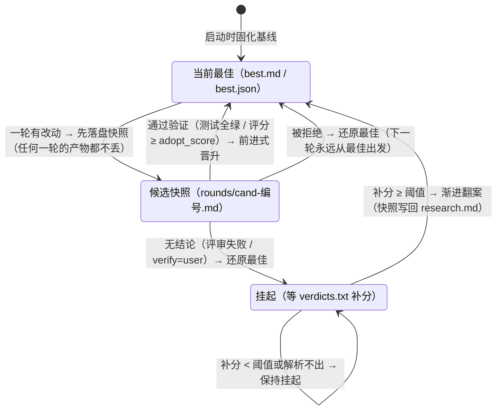

# xuen

一个"随机灵感词 × 外部 agent 模拟人类研究者"的 **TUI** 循环。

xuen **只调用外部 agent**（如 opencode）来完成所有思考：首次运行让外部 agent
生成领域词库；每轮从词库**纯随机**抽取灵感词（此步绝不调任何模型），把
「任务 + 灵感词 + 当前想法区/产物区 + 用户输入」拼成提示词交给外部 agent，
由它覆盖「想法区 / 产物区」。

## 界面（TUI）

```
┌ 修改想法区 ────────────────┐
│ [修改想法区]                │  ← 想法区每次被覆盖后，显示
│ <写入想法区的内容>           │     [修改想法区]<写入想法区的内容>
├ 修改产物区 ────────────────┤
│ [修改产物区]                │  ← 产物区每次被覆盖后，显示
│ <写入产物区的内容>           │     [修改产物区]<写入产物区的内容>
├ 输出日志 ──────────────────┤
│ 外部 agent 的 stdout/stderr │
│ 与循环消息（滚动）            │
├────────────────────────────┤
│ 状态栏                      │
└ 输入框 ⌨                   ┘
  输入内容会在下次调用 agent 时带给 agent
```

- 底部**输入框**：回车提交后进入队列，**下一次调用 agent 时**以
  「【用户输入】」段落拼进提示词带给 agent；
- `q` / `Ctrl+C` 退出（会先终止正在运行的外部 agent）。

## 整体流程

```
python main.py "任务"
   │
   ├─ ① 解析命令行 ──► 加载 config.yaml ──► CLI 覆盖同名配置 ──► 校验
   ├─ ② 初始化工作区：research.md（想法区/产物区）+ 写入助手 write_section.py
   ├─ ③ 构建外部 agent：ShellAgent（按 agent.command 模板，$prompt / $prompt_file）
   │
   ├─ ④ 领域词库（仅 words.pick > 0 时）
   │      words.txt 已存在且 reuse=true ──► 直接复用（--regen-words 强制重建）
   │      否则 ──► 外部 agent 分批生成 ──► 解析/清洗/去重 ──► 原子保存 words.txt
   │
   └─ ⑤ 研究循环 × N 轮（loop.iterations，支持 inf 无限循环）
          1. 纯随机抽词：random.sample 抽 n 个灵感词（此步绝不调任何模型）
          2. 取出底部输入框中积累的用户输入
          3. 拼提示词：extra_notes + 任务 + 轮次 + 灵感词
             + 当前想法区/产物区内容 + 用户输入 + 覆盖区块的写入指令
          4. 调用外部 agent（如 opencode run "$prompt"）：
             思考过程实时打到输出日志；经 write_section.py 整体覆盖想法区/产物区
          5. 重读 research.md 做 diff：哪个区块被改了，
             就在屏幕上显示 [修改xx区]<新内容>
          6. 轮次守卫（rounds.enabled，默认开）：快照 → 验证 → 晋升/还原
             （见下节；守卫异常一律降级，绝不阻断研究循环）
```

### 各阶段说明

**① 启动与配置**（`main.py` → `xuen/cli.py`）
- 解析命令行：任务描述（位置参数 / `--task-file` / 交互输入）、`--iterations`（整数或 `inf`）、
  `--pick`（每轮词数 n ≥ 0）、`--workspace`、`--regen-words`、`--no-tui`、`--no-color`；
- 加载 `config.yaml`（默认查找 `config.yaml` / `config.yml` / `xuen.yaml`，或 `-c` 指定），
  CLI 参数覆盖同名配置，覆盖 `--workspace` 后重新校验。

**② 界面选择**
- 默认启用 TUI（需安装 `textual` 且在真实终端中运行）；
- 条件不满足或指定 `--no-tui` 时，自动降级为纯终端输出。

**③ 工作区初始化**（`xuen/state.py`）
- 创建状态文件 `research.md`：标题为任务，含 `IDEA`（想法区）与 `ARTIFACT`（产物区）
  两个跨轮保留的标记区块；已存在则自动续用；
- 生成独立写入助手 `write_section.py`：外部 agent 用 stdin 整体覆盖指定区块
  （`python write_section.py idea|artifact`），内置跨进程文件锁，防止并发写互相覆盖。

**④ 外部 agent 调用**（`xuen/agents.py`）
- `agent.command` 命令模板支持两种占位符：`$prompt`（整段提示词按所在 shell 语境的
  引号规则转义后替换）、`$prompt_file`（提示词写入工作区内唯一临时文件后替换为路径，
  跨平台推荐）；
- 渲染器跟踪模板的 shell 语法：命令替换 `$(...)` / 反引号、算术语境、heredoc 正文、
  注释、`${...}` 参数展开等无法安全转义的区域不改写占位符（提示词里的 `$(...)` /
  反引号不会被注入执行）；占位符落在这些区域或模板用了 `$'...'` / `$"..."`
  / 数组赋值 `NAME=(...)` 等随 `/bin/sh` 方言变化（或会被 bash 的语法错误恢复
  把后续行当命令执行）的写法时，配置校验直接报错提示，而不是静默丢弃提示词；
- `agent.timeout` 超时后强制终止整个进程树；TUI 中 `q` / `Ctrl+C` 也会先终止正在运行的 agent；
  提示词超过系统单参数上限（`$prompt` 模式）时给出改用 `$prompt_file` 的明确建议并中止循环。

**⑤ 词库生成**（`xuen/words.py`）
- 分批向外部 agent 请求「为研究方向列出 N 个术语/关键词」，程序只负责解析、清洗、去重
  （剥序号/引号/冒号解释等），原子写入 `words.txt`；
- 词表不再增长则提前结束；生成失败时回退复用磁盘上的旧词库；
  `words.pick=0` 时跳过词库，循环中不给灵感词。

**⑥ 研究循环**（`xuen/runner.py`）
- 每轮顺序执行：纯随机抽词 → 收集用户输入 → 拼提示词 → 运行外部 agent → diff 区块变化
  → 轮次守卫（快照/验证/晋升或还原）；
- 提示词要求 agent：输出思考过程（供用户在屏幕前看），并完整保留区块标记行的前提下
  整体覆盖想法区 / 产物区；
- 失败处理：外部 agent 连续 3 次启动/执行失败则中止循环（退出码 1）；
  用户主动停止或至少成功一轮时不计为整体失败。

**⑦ 退出与持久化**
- 所有状态都落在工作区文件里（`research.md` / `words.txt` / `write_section.py` /
  `rounds/`），中断后重跑自动续上；
- 退出码：`0` 正常结束；`1` 所有轮次均执行失败；`2` 配置/参数错误；`130` 被 Ctrl+C 中断。

## 轮次守卫：把「防丢失 + 防倒退」做成独立卖点

（`xuen/rounds.py`，配置段 `rounds:`，默认启用，`--no-rounds` 可关闭）

外部 agent 每轮【整体覆盖】想法区/产物区，旧实现里下一轮无条件继承最新
状态——某轮产出更差方案时，更好的前一轮就被覆盖丢失。轮次守卫是 xuen
区别于「裸跑 agent 循环」的核心机制，四件事共同保证**进度只会前进，
不会倒退，更不会丢失**：每轮快照、候选/最佳分离、自动验证、渐进翻案。

### 一图流：候选的生命周期

快照 → 候选 → 验证 → 晋升/还原，外加一条「渐进翻案」的回环：



终端友好版（与实现一一对应）：

```
每轮结束
  │
  ├─ 无改动 → 记「心跳」，不产生候选
  ├─ 区块标记损坏 → 守卫直接拒绝，还原最佳
  ├─ 有改动 → ① 快照为候选 rounds/cand-<id>.md（候选 ≠ 最佳，绝不直接当最佳）
  │        │
  │        ├─ ② 验证 rounds.verify：
  │        │    auto  有可运行测试套件就跑测试；没有则用 fallback 评分者
  │        │    tests 只跑测试（pytest → make → npm → go 级联）
  │        │    user  只认 verdicts.txt 用户评分（异步、可跨会话补分）
  │        │    ai    复用外部 agent 当评审员（judge_command 可配便宜模型）
  │        │    off   不验证，最新即最佳（退化为「防丢失」模式）
  │        │
  │        ├─ ③ 通过（测试全绿 / 评分 >= rounds.adopt_score）→ 前进式晋升为最佳
  │        │    rounds/best.md + best.json 更新（只增不改，不改写历史）
  │        └─ ③ 失败 / 挂起 → research.md 还原为当前最佳
  │             —— 下一轮【永远从最佳出发】，更差的候选无法污染后续轮次
  │
  ├─ 挂起的候选 ← 用户在 rounds/verdicts.txt 追加「<候选id> <0-10分> [评语]」
  │        └─ 补分 ≥ 阈值 → 前进式翻案：旧快照晋升为最佳并写回 research.md
  └─ 全部事件追加进 rounds/history.jsonl（审计用，只增不改）
```

### 卖点一：`verify: user` 的渐进翻案机制

研究是异步的：现在看起来「没结论」的候选，可能几小时后才被证明有价值。
守卫不强迫用户守在屏幕前打分，而是把评分通道做成了**文件追加协议**——
在 `<workspace>/rounds/verdicts.txt` 里加一行：

```
<候选id> <0-10 分> [评语]
例如： 20261017-031037-r5 8 想法区更有深度，产物区伪代码可落地
```

守卫在每轮结束 / `start()` / `finish()` 三个时机兑现待决评分：挂起的旧
候选一旦补分达到 `adopt_score`，就被**前进式晋升**为最佳并写回
`research.md`——等价于回滚到它，但 `history.jsonl` 不改写一行（审计
日志只增不改，翻案本身也是一条新事件）。补分低于阈值则记为拒绝；
下一轮永远从当前最佳继续。评分通道对各种脏数据免疫：未知候选 id、
打错字的分数、快照被删的候选，都只是保持挂起并提示一次，绝不锁死、
绝不误杀。这套协议天然兼容 CI / 后台循环——verdicts.txt 持久化在
工作区里，跨会话、跨 run 都能兑现。

### 卖点二：`judge_command`——用便宜模型当评审员

验证没结论的候选需要有人打分，但「评审」和「研究」对模型的要求完全
不同：研究要深度思考（强模型 + 高思考档位），评审只需要对比两份文本
给出 0-10 分（快、便宜、稳定就够）。`rounds.judge_command` 允许给评审
员单独配一条命令模板（占位符与 `agent.command` 相同）：

```yaml
rounds:
  verify: ai
  judge_command: 'opencode run -m opencode/deepseek-v4.1-flash-free "$prompt"'
  judge_timeout: 600
```

留空则复用 `agent.command`。评审的严格性不打折：评审员看到的是**候选
快照与当前最佳**（不是可能被外部改写的实时状态），评分 >= `adopt_score`
才采纳；评审员超时、非零退出、输出里解析不出分数，一律按「挂起」处理
——评审员故障 ≠ 候选差，绝不因基础设施问题误杀候选（挂起的候选仍可
事后用 verdicts.txt 翻案）。

### 卖点三：进度永不丢失

所有状态都落在工作区文件里，没有任何内存态：`research.md`（当前状态）、
`words.txt`（词库）、`rounds/cand-*.md`（每轮快照，`O_EXCL` 原子创建，
并发实例也不会互相覆盖）、`rounds/best.md|best.json`（当前最佳，tmp +
`os.replace` 原子写）、`rounds/history.jsonl`（追加式审计日志）。恢复
链按可靠性逐级回退：`best.json` → `history.jsonl` 的采纳事件 → 候选
快照（内容权威：每个晋升过的最佳都有内容完全相同的快照）→ `best.md`
镜像 → 基线重建。进程被 kill / 断电 / 磁盘写坏任何一环，下次启动都能
回到最近的**已验证**进展；启动时还会自动把 `research.md` 拨回最佳，
半截轮次的内容不会污染下一轮的起点。

### 验证方式一览

| `rounds.verify` | 行为 |
|---|---|
| `auto` | 有可运行测试套件就跑测试（pytest → make → npm → go 级联）；没有则用 `rounds.fallback` 评分者 |
| `tests` | 只跑测试；没有套件 / 跑不起来 → 候选挂起，等待用户在 verdicts.txt 评分 |
| `user` | 只认用户评分（verdicts.txt 异步补分，可跨会话翻案） |
| `ai` | 只用 AI 评分（judge_command 可单独配便宜模型，对比候选与当前最佳打 0-10 分） |
| `off` | 不验证：快照照存，最新即最佳（退化为「防丢失」模式） |

Makefile 分支只做存在性检查，「是否真的定义了 test 目标」（写在
ifeq 分支里、include 进来、eval 生成、模式规则、grouped targets……）
由 GNU make 在运行时回答：`make: No rule to make target 'test'` 与
`Nothing to be done for 'test'` 都按「套件不可用」处理，转兜底评分，
而不是误判成测试失败。

要点：

- **每轮保存快照**：任何一轮的产物都落在 `rounds/cand-<id>.md`，永不丢失；
- **候选与最佳分离**：`best.md` / `best.json` 只保存「当前最佳」；候选
  必须通过验证（或拿到高分）才晋升；
- **避免下一轮覆盖更好方案**：被拒绝/待评分的候选立即还原最佳——即使
  agent 连续产出多轮更差的内容，循环状态也始终停在最佳上；
- **agent 失败轮次**同样不留候选（半截产物不可信）并还原最佳；
- **守卫自身异常一律降级**（目录不可写、评审员超时、评分解析不出……），
  绝不阻断研究循环；解析不出分数时按「挂起」处理，既不采纳也不丢弃。

CLI 快捷参数：`--no-rounds`（关闭守卫）、`--rounds-verify auto|tests|user|ai|off`、
`--rounds-fallback user|ai`、`--rounds-score N`（采纳阈值）。

## 使用

```bash
pip install -r requirements.txt        # 或 pip install -e .
cp config.example.yaml config.yaml     # 编辑 agent.command 等

# 配置外部 agent（config.yaml）：
# agent:
#   command: 'opencode run "$prompt"'

python main.py "设计一个新的优化器"              # TUI 模式（默认）
python main.py "设计一个新的优化器" --no-tui     # 纯终端输出
python main.py "设计一个新的优化器" --iterations inf --pick 3
python main.py "设计一个新的优化器" --regen-words
python main.py "设计一个新的优化器" --rounds-verify ai --rounds-score 8
python main.py "设计一个新的优化器" --no-rounds   # 退回旧行为：无快照无最佳

# 循环打磨某个代码仓库：把 rounds.repo 指向它，候选改动会被该仓库的
# 测试套件自动验证（pytest/make/npm/go 级联探测）
```

## 在 CI 里无人值守长跑

`.github/workflows/continuous-loop.yml` 把整套研究循环搬进 GitHub Actions：
任务「**设计一个新的算法**」交给 xuen 跑（约 3 小时工作窗口，窗口到点发
SIGINT 优雅收尾），`rounds.verify: ai` + `rounds.judge_command` 用更快的
免费模型当评审员，主模型从动态模型池里选（优先 deepseek-v4.1-flash-free，
其次 big-pickle，再其次池内随机，带冒烟测试与失效剔除）。

工作区（`research.md` / `words.txt` / `rounds/`）经专用的 `xuen-loop` 分支
跨 run 保存：每次 run 开头恢复、结尾 checkpoint（不动 master，仓库卫生
不受影响）。配合每轮落盘的守卫快照，任何一次 run 中途挂掉，下一次也能
从最近的已验证进展继续——这就是「进度会保存」的完整闭环。

## 目录结构

```
xuen/
├── main.py                    # 入口
├── requirements.txt           # 运行时依赖（PyYAML / textual）
├── requirements-ci.txt        # CI 固定版本依赖（含 pytest / rich）
├── pyproject.toml             # 包元数据；pip install -e . / .[dev]
├── config.example.yaml        # 复制为 config.yaml 使用
├── scripts/check_file_size.py # 3,000 行体量门禁（CI 独立 step）
├── .github/workflows/         # CI（pytest）/ xuen 自动研究循环（continuous-loop）
├── tests/                     # pytest：守卫、shell 渲染、TUI 降级、仓库卫生、冒烟
└── xuen/
    ├── cli.py                 # 命令行（TUI 导入失败时降级到纯终端）
    ├── config.py              # 配置（含 rounds 与 prompt 预算段）
    ├── tui.py                 # TUI（textual）：区块面板 + 日志 + 底部输入框
    ├── sink.py                # 输出通道抽象（控制台 / TUI 共用）
    ├── ui.py                  # 纯终端输出（--no-tui）
    ├── state.py               # research.md（想法区/产物区）+ 写入助手脚本
    ├── words.py               # 词库：外部 agent 生成 / 解析 / 抽样
    ├── procs.py               # 跨平台进程工具
    ├── agents.py              # ShellAgent + 命令模板的 shell 转义/安全检查
    ├── rounds.py              # 轮次守卫：快照/验证/晋升/还原 + 渐进翻案
    │                          #（Makefile 是否定义 test 目标由 make 运行时判定）
    └── runner.py              # 主循环编排
```

`agents.py` 体量较大，因为包含完整的 shell 模板解析与安全检查；`rounds.py`
则是全面重写后的紧凑实现（约 1500 行含文档）：Makefile 不再做数千行
静态解析，「是否定义了 test 目标」由 GNU make 在运行时回答，最佳内容的
权威源是候选快照（best.md 只是镜像）。工作区的运行期状态
（`.rounds/`、`research.md`、`words.txt`、`write_section.py`、`rounds/`）
都在 `.gitignore` 中，不进入版本库；CI 自动循环的工作区进度经专用的
`xuen-loop` 分支保存，master 保持干净。

## 代码体量纪律

**3,000 行是单文件红线。** `scripts/check_file_size.py` 扫描仓库内所有
手写 `.py` 文件（排除 `pkg.generated*`、缓存目录与虚拟环境），任何文件
超过 3,000 行都会打印路径并以非零码退出；CI 在 push / PR 时把它作为
独立 step 执行。生成物不计入，但人工维护的源码没有例外。

这条红线来自一次真实的自纠：`xuen/rounds.py` 曾膨胀到 7,704 行，随后
被全面重写压缩到 1,473 行。重写的关键不是「拆函数」，而是**删掉不必要的
实现**——不再静态解析 Makefile 的数千行结构，改由 GNU make 在运行时回答
「是否定义了 test 目标」；最佳内容的权威源收敛到候选快照，避免多份状态
互相镜像、各自膨胀。经验是：体量失控往往源于重复职责和防御性追加，而
不是缺少抽象。

因此修改代码时遵循：

- **优先删减，而非追加。** 能删掉的旧路径、重复状态、无效兼容层优先
  删除；新增逻辑前先确认现有实现不能收拢复用。
- **按职责拆分，而不是按行数切块。** 单文件接近红线时，先识别可独立的
  渲染、解析、提示词组装等职责，再迁到同包模块；测试按被测功能拆分。
- **拆分只做物理重组。** 移动代码不改变逻辑、不削弱断言；现有测试必须
  保持全绿。当前 `tests/test_agents_render*.py` 已按 heredoc/命令替换、
  复杂展开、Windows 引号与提示词文件生命周期拆成三组，每组均低于
  1,500 行。
- `xuen/agents.py` 目前把 shell 模板扫描、占位符边界与进程生命周期
  耦合在 `ShellAgent` 上，暂不强拆；文件头已标注红线，若继续增长应优先
  迁出纯渲染/扫描辅助逻辑。

## 提示词预算

每轮提示词都会附带完整的想法区/产物区；轮次多了以后会单调增长，最终可能
超过外部 agent 的上下文上限。配置 `prompt.max_state_chars`（默认 60000）
给两区总字符数设上限：

```yaml
prompt:
  max_state_chars: 60000   # 0 = 不限制
```

超出时只截断**提示词副本**：保留首尾、中间标注省略字符数，并提示完整内容
仍在 `research.md`；工作区文件本身不会被裁剪。

## 开发与测试

```bash
# 运行时依赖
pip install -r requirements.txt
# 开发安装（含 pytest / pytest-cov）
pip install -e ".[dev]"
# 或不装包、只装开发依赖
pip install -r requirements-dev.txt

pytest -q
pytest --cov=xuen --cov-report=term-missing
```

测试覆盖轮次守卫、shell 提示词渲染/注入防护、TUI 降级路径、仓库卫生
（运行产物不得被跟踪）、CLI 与冒烟流程。CI 使用 `requirements-ci.txt`
的固定版本依赖；本地 `requirements.txt` 与 `pyproject.toml` 的运行时依赖
保持同步。

默认分支是 `master`。其它 MoonBit 仓库使用 `main`；本仓库暂保留 `master`
以避免打断已有 CI/外部链接，迁移时会单独做一次带历史的重命名。

## 需求对照

| 需求 | 实现 |
|---|---|
| 只调用外部 agent（如 opencode） | 外部 agent 调用集中在 `ShellAgent`（`agents.py` 同时含 shell 模板转义/安全检查）；词库也由外部 agent 生成；无直连 LLM / 内置工具 / MCP |
| 配置 shell 命令调用外部 agent | `agent.command`，`$prompt` / `$prompt_file` 占位符 |
| TUI | `textual` 实现，默认启用（`--no-tui` 关闭）；未安装 textual 时自动降级 |
| 修改想法区显示 `[修改想法区]<写入想法区的内容>` | 「修改想法区」面板：想法区被覆盖后显示标记 + 新内容 |
| 修改产物区显示 `[修改产物区]<写入产物区的内容>` | 「修改产物区」面板：产物区被覆盖后显示标记 + 新内容 |
| 底部输入框，内容下次调用 agent 时带给 agent | 输入入队 → 下一轮提示词中带「【用户输入】」段落 |
| 想法区+产物区持久化 | `research.md`（标记区块），重跑自动续上；写入前校验标记结构并原子替换 |
| 每轮保存快照，区分候选与当前最佳 | `rounds/cand-<id>.md` 候选快照 + `rounds/best.md|best.json` 当前最佳 + `history.jsonl` 审计日志 |
| 能用测试验证的就运行测试 | `rounds.repo`（默认自动探测 git 根）：pytest → make → npm → go 级联 |
| 不能测试验证的：用户评分 / AI 评分 | `verdicts.txt` 异步补分（可翻案旧候选） / 复用外部 agent 当评审员打分 |
| 避免下一轮覆盖更好方案 | 候选失败/挂起即还原最佳；下一轮永远从最佳出发；采纳旧快照用前进式晋升、不改写历史 |
| 提示词不随轮次无限增长 | `prompt.max_state_chars` 首尾截断 + 截断提示；完整内容保留在状态文件 |
| CI 自动循环调用 xuen 且进度可续 | `continuous-loop.yml`：任务「设计一个新的算法」，verify=ai + 便宜模型评审员；工作区经 `xuen-loop` 分支跨 run 保存 |

**注意事项**：所有状态都在工作区文件里（`research.md` / `words.txt` / `rounds/`），中断后重跑自动继续；
`agent.timeout` 控制单次外部调用超时。仓库根目录的 `.rounds/` 是运行期产物，
已被移除并加入 `.gitignore`，请勿再提交。
